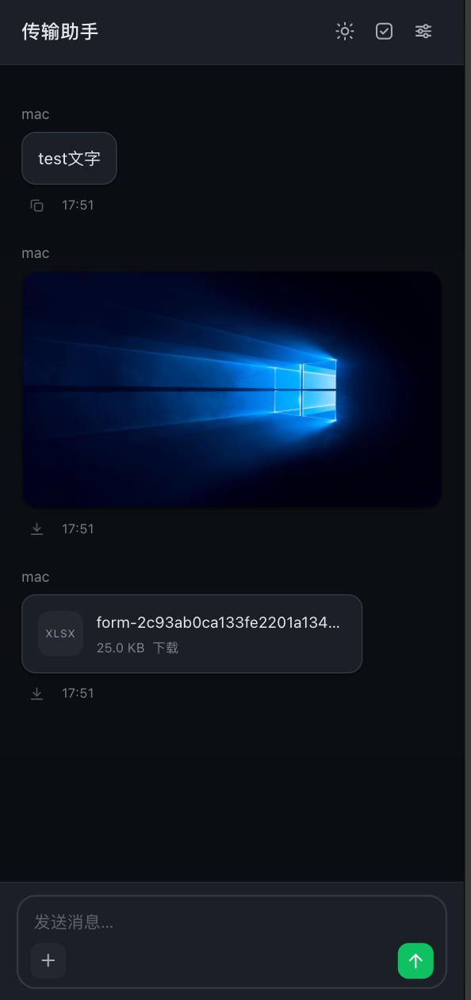

# 传输助手 FileHelper

自托管的网页文件与文字互传工具。

打开网页就能在手机、电脑、平板之间发文字、传图片、传文件，不用登录、不用装客户端，界面仿微信聊天。

适合放在家里的 NAS、树莓派或小主机上，只在局域网或 Tailscale 内使用。

<p align="center">
  
  &nbsp;&nbsp;
  
</p>

## 特性

**传输**
- 文字、图片、视频、音频、其他文件五类统一进一条消息流
- 上传分片 16MB、3 路并发写入，弱网链路也能吃满带宽
- 断点续传：关掉浏览器再打开，从断点继续
- 随时取消上传，中间文件立刻清掉
- 拖拽、粘贴、多选文件上传
- 图片内联缩略，点击看大图；视频与其他文件显示为文件卡片

**使用**
- 无登录，打开即用
- 消息实时同步（SSE），别的设备发的立刻出现
- 文字消息一键复制
- 单选、多选删除，清空全部需二次确认
- 浅色 / 深色主题，首次访问跟随系统

**设置**
- 存储目录可改，改动时自动迁移已有文件（同盘秒完成，跨盘后台拷贝）
- IP 白名单，留空表示全部放行
- 分片大小、临时文件保留时长、临时文件配额

**实现**
- 零依赖：单文件 Node 后端 + 单文件 HTML 前端，无构建步骤
- 流式写盘，传 4G 文件内存也不涨
- 索引全在内存，列表分页不扫盘
- 前端消息节点上限 600，长用不卡
- index.html gzip 后约 13KB

## 快速开始

```bash
git clone <repo>
cd filehelper
node app/server.mjs
```

打开 http://localhost:3100

需要 Node.js 20 以上，无第三方依赖。

## 配置

首次启动会生成 `config.json`（或从 `config.example.json` 复制）。

```json
{
  "port": 3100,
  "host": "0.0.0.0",
  "dataDir": "/mnt/disk/filehelper/data",
  "allowIps": [],
  "chunkSizeMB": 16,
  "partTtlHours": 24,
  "partQuotaGB": 50
}
```

| 字段 | 说明 |
|---|---|
| port | 监听端口 |
| host | 监听地址，默认 0.0.0.0 |
| dataDir | 存储目录，设置页可改 |
| allowIps | 白名单，空数组=全部放行，支持 CIDR，仅 IPv4 |
| chunkSizeMB | 上传分片大小，1–64 |
| partTtlHours | 未完成上传的临时文件保留小时数，1–720 |
| partQuotaGB | 临时文件总量上限，超出从最旧的删，1–400 |

设置页的改动立即生效并写回文件。

## 部署

`/etc/systemd/system/filehelper.service`：

```ini
[Unit]
Description=FileHelper transfer station
After=network-online.target
Wants=network-online.target

[Service]
Type=simple
WorkingDirectory=/opt/filehelper
ExecStart=/usr/bin/node /opt/filehelper/app/server.mjs
Restart=always
RestartSec=3

[Install]
WantedBy=multi-user.target
```

```bash
systemctl daemon-reload
systemctl enable --now filehelper
```

不需要 nginx。Node 直接提供静态文件和接口，少一层缓冲，大文件上传更稳。

## 接口

| 方法 | 路径 | 说明 |
|---|---|---|
| GET | `/api/items?limit=&cursor=` | 游标分页列表，时间倒序 |
| GET | `/api/settings` | 配置 + 存储统计 + 迁移状态 |
| PUT | `/api/settings` | 保存配置，改目录会触发迁移 |
| POST | `/api/text` | 发文字 |
| POST | `/api/upload/init` | 询问续传位置，返回 uploadId 与 offset |
| PUT | `/api/upload/chunk?uploadId=&offset=` | 传一片，支持任意顺序 |
| POST | `/api/upload/finish` | 校验区间覆盖后落盘 |
| POST | `/api/upload/cancel` | 放弃并删除临时文件 |
| GET | `/f/<kind>/<name>` | 下载或预览，支持 Range |
| POST | `/api/delete` | 批量删除 |
| POST | `/api/clear` | 清空全部 |
| POST | `/api/rescan` | 以磁盘为准重建索引 |
| GET | `/api/events` | SSE，推送新增、删除、迁移进度 |

## 目录结构

```
filehelper/
├── app/
│   ├── server.mjs          后端，零依赖
│   └── public/index.html   前端，单文件
├── config.json             运行时配置（不入库）
├── config.example.json     配置样例
└── data/
    ├── text/    文字
    ├── image/   图片
    ├── video/   视频
    ├── audio/   音频
    ├── file/    其他
    └── .part/   上传中的临时文件
```

文件名格式 `YYYYMMDD-HHMMSS-<4位随机>-<设备>__<原文件名>`，排序即时间序，索引可从文件名完整重建。

## 设计说明

**为什么分片 + 并发**

单请求串行上传时，每片结束都要等一个 RTT，TCP 窗口反复收缩，实测只能跑满链路的一半。改成 16MB 分片、3 路并发后，同一条链路从 1.7 MB/s 提升到 3.7 MB/s。

**为什么服务端支持乱序写**

并发分片必然乱序到达。服务端用 `r+` 模式按 `start` 定位写入，结束时检查区间是否覆盖 `[0, size)`，缺片直接返回 409，而不是相信文件长度。

**为什么不用 nginx**

Node 直接收流，天然没有 `proxy_request_buffering` 把大文件塞进内存的问题。

**踩过的坑**

- Node 默认 `requestTimeout` 是 5 分钟，大文件上传会被掐断，已显式设为 0
- HTTP 环境不是安全上下文，`navigator.clipboard` 不可用，复制走 `execCommand` 降级
- 临时文件必须先写 `.part` 再 `rename`，否则列表会看到半截文件

## 注意

- 没有鉴权。只在内网或 VPN 里跑，别直接暴露公网。
- 删除即删文件，没有回收站。
- 视频不在列表里内联播放，点卡片下载。

## License

MIT
